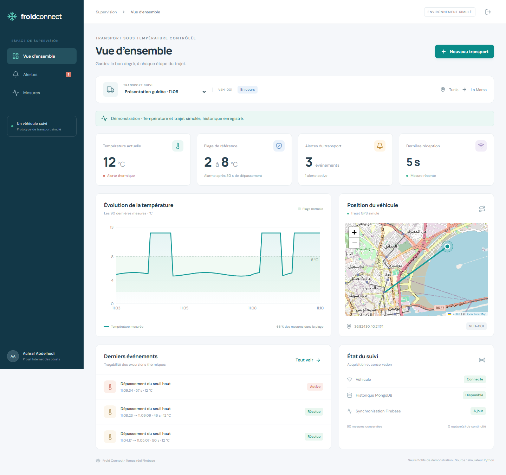

# Froid Connect — Chaîne du froid intelligente

Prototype pédagogique pour un véhicule simulé : ESP32 et DS18B20 dans Wokwi, API FastAPI, historique MongoDB, état courant Firebase Realtime Database et tableau de bord React en français.

Les seuils **2–8 °C**, le délai d’alarme **30 secondes** et le trajet Tunis–La Marsa sont fictifs. L’extension prédictive n’est pas incluse dans cette version.

**Auteur : Achraf Abdelhedi** · [Simulation Wokwi](https://wokwi.com/projects/478408633765115905) · [Guide de présentation](docs/PRESENTER_LE_PROJET.md) · [Bilan des vérifications](docs/VERIFICATION.md)



La capture montre des mesures synthétiques envoyées par Python à la vraie API, conservées dans MongoDB et synchronisées avec Firebase local. Le capteur et l'alarme locale ont été observés dans Wokwi ; la transmission HTTPS directe Wokwi → serveur reste à finaliser.

## Récupérer le projet

```powershell
git clone https://github.com/Achraf1000/froid-connect-iot.git
cd froid-connect-iot
```

Suivre ensuite la section **Installation sur une autre machine Windows**. Les fichiers `.env`, `firmware/coldchain_config.h`, les bases de données, les journaux et les fichiers d'exécution locaux ne sont pas publiés. Les scripts génèrent une configuration propre au poste.

## Sur ce poste

**Présentation immédiate : double-cliquer sur `DEMONSTRATION.cmd`.** Le [guide de présentation](docs/PRESENTER_LE_PROJET.md) donne le déroulé, les touches pour déclencher une alerte et les explications à donner. Le tableau de bord reçoit des données explicitement simulées par Python via la vraie API, MongoDB et Firebase local. La démonstration du montage Wokwi reste indépendante tant que sa transmission HTTPS n'est pas validée.

Pour démarrer sans saisir de commandes, double-cliquer sur **LANCER_PROJET.cmd**. Le [guide de démarrage rapide](docs/DEMARRAGE_RAPIDE.md) explique la connexion et les fichiers à actualiser dans Wokwi. **ARRETER_PROJET.cmd** arrête les services en conservant les données.

Le projet se trouve dans `C:\IRM\IOT\cold-chain-iot`. Le tableau de bord est servi à **http://127.0.0.1:8000**. Son mot de passe est dans `.runtime/acces-local.txt`, généré localement et exclu de Git.

L’environnement préparé utilise Node.js 24 dans `.tools`, Python dans `.venv`, MongoDB dans un conteneur dédié sur le port **27018**, et les émulateurs Firebase locaux sur **9000/9099**. La base MongoDB préexistante sur 27017 n’est pas utilisée.

Le jeu de démonstration porte explicitement la source « simulateur Python ». Les mesures Wokwi porteront la source « Wokwi ».

## Relancer le projet

Ouvrir PowerShell dans ce dossier et démarrer Docker Desktop, puis :

```powershell
.\scripts\start.ps1 -Tunnel
```

Le script lance les services en arrière-plan. Si PowerShell bloque les scripts locaux, cette commande limite l’exception à l’exécution demandée :

```powershell
powershell -ExecutionPolicy Bypass -File .\scripts\start.ps1 -Tunnel
```

Le tunnel utilise la configuration ngrok déjà présente sur le poste. Le lanceur attend les services puis prépare automatiquement les fichiers Wokwi ; son URL est enregistrée dans `.runtime/tunnel-url.txt`. Le démarrage des émulateurs peut prendre quelques secondes ; consulter les journaux `.runtime` en cas de problème.

Pour arrêter les processus de développement lancés par le script :

```powershell
.\scripts\stop.ps1
```

Ajouter `-WithMongo` pour arrêter aussi le conteneur MongoDB. Les volumes de données sont conservés.

## Installation sur une autre machine Windows

Prérequis : Python 3.12, Git, Docker Desktop avec conteneurs Linux, Java 17 ou 21 pour les émulateurs locaux et Internet pour l’installation/Wokwi. ngrok est nécessaire uniquement pour relier Wokwi dans le navigateur à l’API locale.

```powershell
.\scripts\setup.ps1
.\scripts\start.ps1
```

`setup.ps1` crée un environnement Python, télécharge une distribution officielle Node.js 24 isolée et vérifie son SHA-256, génère les secrets locaux, installe les dépendances verrouillées puis construit le tableau de bord. Il conserve les installations globales existantes.

Sans le script Windows : créer un environnement Python, installer `backend/requirements.lock.txt`, installer Node.js 24, lancer `npm ci` à la racine et dans `frontend`, puis `npm --prefix frontend run build`. Copier `.env.example` vers `.env` et remplacer ses trois valeurs de secrets par des valeurs aléatoires.

## Lancement entièrement conteneurisé

Le profil `full` comprend MongoDB, Firebase et l’application avec l’interface compilée.

```powershell
.\scripts\stop.ps1
docker compose --profile full up -d --build
```

Ouvrir http://127.0.0.1:8000. Le fichier `.env` doit exister ; le mot de passe est identique au mode de développement. Ne pas lancer simultanément les émulateurs/API natifs et le profil complet sur les mêmes ports. Le tunnel peut être lancé séparément avec `ngrok http http://127.0.0.1:8000`.

```powershell
docker compose --profile full ps
docker compose --profile full logs --tail 50 app
docker compose --profile full stop
```

MongoDB conserve l’historique dans un volume. Le contenu courant Firebase est reconstructible depuis MongoDB : le serveur le republie au démarrage et périodiquement. Aucune donnée métier ne dépend de la persistance de l’émulateur.

## Alimenter la démonstration sans Wokwi

Injecter 100 mesures historiques explicitement synthétiques, contenant une excursion et un retour à la normale :

```powershell
.\.venv\Scripts\python.exe scripts\simulate.py --scenario demo --count 100
```

Les horodatages couvrent le passé et se terminent à l’instant de lancement. Après 15 secondes sans nouvelles mesures, l’affichage « données anciennes » est donc attendu.

Pour un flux en direct de cinq minutes :

```powershell
.\.venv\Scripts\python.exe scripts\simulate.py --scenario normal --count 60 --realtime
```

Les scénarios disponibles sont `normal`, `short`, `long`, `low` et `demo`. `--transport TRIP-ESSAI-001` crée un transport séparé si nécessaire. Éviter d’injecter un flux Python en même temps que Wokwi sur le même transport : un véhicule correspond à une session active à la fois.

## Wokwi et essais à réaliser avec l’utilisateur

Suivre [le guide de test Wokwi](docs/TEST_WOKWI.md). Aucune clé API Wokwi n’est nécessaire pour le parcours dans le navigateur. Les fichiers sont prêts dans `firmware/`.

La compilation locale utilise PlatformIO :

```powershell
.\.venv\Scripts\python.exe -m platformio run -d firmware
```

Le fichier `wokwi.toml` permet aussi d’utiliser le binaire avec l’extension VS Code si l’utilisateur dispose de son accès Wokwi. Cette option est distincte du parcours navigateur.

## Fonctionnement et garanties du prototype

- Lecture locale et émission nominales toutes les 5 secondes.
- Plage normale inclusive : 2 à 8 °C. Dépassement strictement hors plage.
- Durée de 30 secondes calculée à partir de la première lecture hors plage ; déclenchement à la première mesure atteignant cette durée.
- Un événement par excursion, conservé après retour à la normale.
- Buzzer et LED commandés localement. Les requêtes réseau s’exécutent dans une tâche ESP32 séparée.
- Tampon RAM de 120 mesures, soit environ 10 minutes. Le débordement supprime les plus anciennes et incrémente un compteur ; une extinction perd le tampon.
- Identité stable `(vehicle_id, boot_id, sequence)` : un renvoi identique ne crée pas de doublon. Un contenu différent avec la même identité est rejeté.
- Acquittement HTTP après écriture MongoDB. Une panne MongoDB donne une erreur récupérable.
- Projection de l’historique vers les états et alertes, puis vers Firebase. Une panne Firebase ne supprime pas les mesures.
- Les temps monotones du capteur contrôlent la temporisation. Les dates UTC servent à l’historique et à la fraîcheur.
- Une séquence manquante, un intervalle supérieur à 10 secondes, une erreur capteur ou un redémarrage interrompent la preuve de continuité. Une alerte interrompue n’est pas marquée « résolue ».
- Les mesures reçues tardivement complètent l’historique et peuvent reconstruire une séquence sans faire reculer la mesure actuelle.
- L’interface écoute Firebase et utilise aussi l’API pour l’historique et le suivi de secours.

La projection relit le transport concerné. Ce choix convient au prototype à un véhicule et à des démonstrations de quelques centaines ou milliers de mesures. Une exploitation de longue durée demanderait une projection incrémentale, une rétention et des agrégations.

Exécuter **un seul processus Uvicorn** pour conserver un traitement de projection unique. Le prototype ne prétend pas assurer une transaction atomique entre MongoDB et Firebase.

## Authentification et configuration

Le tableau de bord utilise un mot de passe local et une session HTTPOnly de huit heures. La télémétrie utilise une clé distincte limitée à son endpoint. L’accès direct à Firebase exige un utilisateur autorisé, et les écritures du navigateur sont refusées.

`/health` est public ; les données et `/ready` sont protégés. La documentation OpenAPI est disponible sur `/docs`.

Les fichiers suivants restent privés et sont exclus de Git : `.env`, `.runtime`, `firmware/coldchain_config.h` et les clés de compte de service. Le fichier de firmware contient une clé de démonstration : éviter de le publier dans un projet Wokwi public et renouveler la clé après un partage.

Le client ESP32 vérifie le certificat HTTPS à l’aide d’une autorité de confiance. `scripts/configure_wokwi.py` prépare la configuration à partir du tunnel, après vérification HTTPS. Il ne désactive pas la vérification TLS.

## Brancher un vrai projet Firebase

Les premiers essais fonctionnent sans compte cloud. Pour la démonstration cloud, fournir l’identifiant du projet, l’URL Realtime Database et la configuration de l’application Web. Placer la clé de compte de service sur le poste, en dehors du dépôt, puis adapter `.env` :

```dotenv
FIREBASE_MODE=cloud
FIREBASE_PROJECT_ID=votre-projet
FIREBASE_DATABASE_URL=https://votre-base.firebasedatabase.app
FIREBASE_WEB_API_KEY=cle-web-du-projet
FIREBASE_AUTH_DOMAIN=votre-projet.firebaseapp.com
GOOGLE_APPLICATION_CREDENTIALS=C:/chemin-prive/service-account.json
```

Déployer les règles de `firebase/database.rules.json` dans ce projet. Le serveur émet des jetons pour l’utilisateur `dashboard`. Si `FIREBASE_READER_UID` est modifié, mettre également à jour la règle. Redémarrer l’API et valider la lecture authentifiée, le refus d’écriture et une nouvelle mesure.

Cette connexion cloud reste à valider avec les accès de l’utilisateur. Les clés Web Firebase identifient le projet ; la protection des données dépend des règles et des droits du serveur.

## Vérification

Tests Python sans services externes :

```powershell
.\.venv\Scripts\python.exe -m pytest -q
```

Tests avec MongoDB sur 27018 et les émulateurs sur 9000/9099 :

```powershell
$env:RUN_INTEGRATION = "1"
.\.venv\Scripts\python.exe -m pytest -q --junitxml=.runtime\pytest-results.xml
```

Le test d’intégration crée puis supprime uniquement sa propre base temporaire et sa propre entrée Firebase.

Vérification navigateur, après démarrage et injection du scénario `demo` :

```powershell
$taskNode = (Get-Content .tools\node-path.txt -Raw).Trim()
$env:PATH = "$taskNode;$env:PATH"
npx playwright install chromium
npm run test:browser
```

Les essais navigateur couvrent la connexion, les données réelles de l’API, Firebase, les alertes, le CSV, la pagination, la présentation mobile et une perte API.

```powershell
.\.venv\Scripts\python.exe -m ruff check backend scripts
npm --prefix frontend run build
```

Les résultats effectivement obtenus et les vérifications encore manuelles sont consignés dans [le rapport de vérification](docs/VERIFICATION.md).

## Repères du dépôt

| Dossier | Contenu |
|---|---|
| `backend/app` | API, modèles, règles, MongoDB et publication Firebase |
| `backend/tests` | Tests unitaires, API et intégration |
| `frontend/src` | Tableau de bord React, graphique, carte et écoute Firebase |
| `firmware` | Programme ESP32, montage Wokwi et configuration exemple |
| `firebase` | Règles d’accès et conteneur d’émulateurs |
| `scripts` | Installation, lancement, simulation et préparation Wokwi |
| `tests/browser` | Scénarios Playwright |
| `docs` | Plan, recette manuelle et rapport de vérification |

La recette Wokwi, le buzzer entendu réellement, la démonstration cloud et la validation pédagogique restent distincts des tests automatisés locaux.
