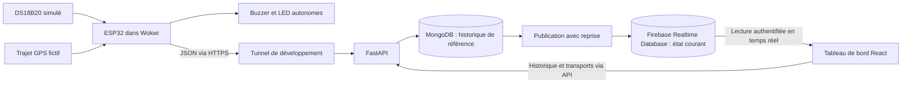

Plan de réalisation — Chaîne du froid intelligente
=================================================

Préparé le 20 octobre 2026 pour Achraf Abdelhedi.

Ce plan repose sur les deux pages de `Plan_Realisation_IoT_Chaine_du_Froid_Achraf_Abdelhedi.pdf`, daté du 12 octobre 2026, et sur une vérification en lecture seule de l’environnement de travail. Il décrit les travaux à réaliser ; les tests fonctionnels présentés ci-dessous ne sont pas encore exécutés.

Le PDF est une proposition soumise à validation. La validation de l’enseignant et le contenu de l’énoncé original `Liste_des_sujets_iot.docx` ne sont pas disponibles. Les précisions apportées ici sont des choix techniques proposés, à distinguer des exigences effectivement écrites dans le PDF.

**Analyse du document**

Le projet couvre une chaîne IoT complète : acquisition d’une température, transport des données, détection d’une anomalie prolongée, stockage et visualisation. Le périmètre d’un seul véhicule simulé est adapté à un prototype pédagogique en quatre semaines, sous réserve de la disponibilité du temps de travail et des accès nécessaires.

| Élément | Ce que prévoit le PDF | Précision proposée pour la réalisation |
|---|---|---|
| Simulation | Wokwi, ESP32, DS18B20, buzzer | Arduino/C++, mesure et émission toutes les 5 secondes ; LED complémentaire pour rendre l’alarme visible sur le montage |
| Position | Trajet GPS prédéfini | Liste de coordonnées fictives parcourue par le firmware ; aucun module GPS réel nécessaire |
| Serveur | FastAPI, communication HTTP(S) | API JSON versionnée, validation stricte, authentification de l’émetteur et traitement des doublons |
| Stockage | Firebase pour l’état actuel, MongoDB pour l’historique | Firebase Realtime Database explicitement retenu ; MongoDB comme référence durable |
| Interface | React, température, courbe, carte, connexion, alertes | Un tableau de bord en français, avec distinction entre état thermique et fraîcheur des données |
| Alertes | Plage fictive 2–8 °C, dépassement continu de 30 secondes | Bornes incluses, temporisation remise à zéro au retour dans la plage, un événement par excursion |
| Coupure réseau | Buzzer local, données anciennes, reprise des envois | Acquisition indépendante du réseau, tampon limité, renvoi avec identifiants stables |
| Livraison | Git/GitHub, Docker, tests, guide, rapport, démonstration | Installation reproductible, commandes de test, preuves de recette et scénario chronométré |
| IA | Extension éventuelle selon l’enseignant | Lot séparé, après validation du fonctionnement principal |

Les principaux risques techniques sont la liaison Wokwi–API locale, les écritures dans deux bases distinctes et le calcul d’une durée lorsque des mesures sont retardées ou absentes. Le planning commence par lever le premier risque et prévoit des tests spécifiques pour les deux autres.

**Environnement constaté sur ce poste**

Vérification effectuée dans `C:\IRM\IOT`. Le dossier `cold-chain-iot` était vide avant la rédaction de ce plan.

| Composant | Observation | Action prévue |
|---|---|---|
| Windows | Windows 11 Famille, 64 bits ; environ 15,7 Go de RAM | Utiliser des conteneurs Linux via WSL 2 |
| Python | 3.12.9 ; pip 25.0 | Créer un environnement `.venv` propre au projet |
| Git | 2.51.0 | Initialiser le dépôt et prévoir un dépôt distant si disponible |
| Node.js / npm | 20.19.5 / 10.8.2 | Prévoir Node.js 24 LTS pour le projet |
| VS Code | Commande disponible | Utiliser l’éditeur existant |
| Docker / Compose | Client 25.0.3 / Compose 2.24.6 | Démarrer Docker Desktop, puis vérifier le moteur et un conteneur |
| Moteur Docker | Échec de connexion au moteur lors du contrôle | Diagnostiquer au démarrage ; la présence du client ne valide pas le fonctionnement des conteneurs |
| WSL | 2.1.5.0, version de distribution par défaut : 2 | Vérifier le démarrage de Docker avec ce backend |
| Java | OpenJDK 17.0.16 | Vérifier la compatibilité avec la version d’émulateur Firebase retenue |
| Tunnel | Commande `ngrok` repérée dans le PATH ; `cloudflared` absent du PATH | Vérifier ngrok et sa configuration avant de choisir une alternative |
| Comptes externes | Disponibilité non vérifiée | Recenser Wokwi, Firebase, ngrok et éventuellement GitHub |

Node.js 20 est indiqué en fin de support dans le calendrier officiel, tandis que Node.js 24 est LTS. Le changement proposé vise une base maintenue. [Versions Node.js](https://nodejs.org/en/about/previous-releases)

Docker documente l’utilisation de WSL 2 et des conteneurs Linux sur Windows Home. La validation pratique du moteur reste à faire sur ce poste. [Docker Desktop pour Windows](https://docs.docker.com/desktop/setup/install/windows-install/)

**Architecture retenue pour le plan**



MongoDB fonctionnera d’abord dans Docker. MongoDB Atlas sera facultatif si un hébergement distant est demandé. Les tests utiliseront les émulateurs Firebase Realtime Database et Authentication ; une vérification sur le projet Firebase réel sera prévue avant la démonstration cloud.

La passerelle publique Wokwi accède à Internet, mais pas directement au réseau local. Le premier essai réseau utilisera donc un tunnel HTTPS vers FastAPI. Une passerelle privée Wokwi est une alternative si l’utilisateur dispose de l’offre correspondante. [Réseau ESP32 dans Wokwi](https://docs.wokwi.com/guides/esp32-wifi)

L’interface écoutera l’état courant dans Firebase et consultera l’historique via FastAPI. Firebase permet les abonnements aux modifications ainsi que le développement avec un émulateur local. [Lecture et écriture Firebase](https://firebase.google.com/docs/database/web/read-and-write)

**Règles fonctionnelles à fixer avant le développement**

Les valeurs suivantes sont des paramètres fictifs de démonstration, conformément au PDF.

| Paramètre | Valeur de départ proposée |
|---|---|
| Véhicule | `VEH-001` |
| Transport | Identifiant distinct pour chaque démonstration |
| Lecture du capteur et émission | Toutes les 5 secondes |
| Température normale | `2 ≤ température ≤ 8 °C` |
| Dépassement | Température strictement inférieure à 2 °C ou supérieure à 8 °C |
| Déclenchement | Au moins 30 secondes écoulées depuis la première mesure hors plage, avec continuité des mesures valides |
| Retour à la normale | Première mesure valide dans la plage ; arrêt du buzzer et clôture de l’événement |
| Données anciennes | Plus de 15 secondes sans mesure récente, seuil ajustable |
| Rupture de continuité | Intervalle de mesure supérieur à 10 secondes, erreur capteur ou changement de session |
| Tampon réseau | 120 mesures en mémoire, soit environ 10 minutes à cadence nominale |
| Horodatage | UTC pour les mesures ; date de réception ajoutée séparément par le serveur |

Le compteur mesure une durée ; il ne compte pas simplement six messages. Avec un premier dépassement à `t=0` et une lecture toutes les 5 secondes, la mesure à `t=30` est la septième mesure de la séquence.

Le firmware utilisera une horloge monotone pour la durée locale, indépendante des corrections de l’heure UTC. Le serveur utilisera la séquence et les temps de mesure, et non l’espacement des arrivées HTTP. Une simulation ralentie peut décaler le temps simulé et le temps réel : les tests du buzzer seront mesurés dans les journaux de simulation, tandis que la fraîcheur réseau sera évaluée en temps réel.

La continuité est une convention fondée sur des échantillons, pas une observation physique entre deux lectures. Une lacune ne permet pas d’affirmer que la température est restée hors plage. Pendant une coupure, le tableau de bord conserve le dernier état connu et le signale comme ancien ; il ne déclare pas un retour à la normale. Après réception d’une séquence complète mémorisée, le serveur peut reconstruire l’historique. Si des mesures manquent définitivement, l’intervalle reste signalé comme incomplet.

La règle de seuil et de durée sera identique dans le firmware et dans FastAPI, avec un numéro de configuration commun. Leur concordance sera vérifiée sur les mêmes scénarios. Le buzzer dépendra des lectures locales, y compris lorsque l’API ne répond pas.

**Données et échanges proposés**

Exemple de mesure, à figer dans un contrat d’API avant le développement :

```json
{
  "schema_version": 1,
  "config_version": 1,
  "vehicle_id": "VEH-001",
  "transport_id": "TRIP-DEMO-001",
  "boot_id": "session-demo-001",
  "sequence": 42,
  "measured_at": "2026-10-20T10:00:00Z",
  "uptime_ms": 210000,
  "temperature_c": 5.5,
  "latitude": 36.8065,
  "longitude": 10.1815,
  "sensor_status": "ok",
  "local_alarm": false
}
```

L’identifiant logique `(vehicle_id, boot_id, sequence)` évitera les doublons lors des renvois. Le serveur ajoutera `received_at`. Une mesure de température ne sera acceptée que si elle est numérique, finie et cohérente avec le capteur ; les latitude et longitude seront contrôlées. En cas de panne capteur, un message de diagnostic explicite avec température absente remplacera toute valeur fictive.

Les horodatages futurs incohérents seront rejetés ou marqués selon une tolérance documentée. Une heure UTC non synchronisée sera signalée ; elle ne sera pas inventée à partir de la date de réception. Les temps monotones resteront utilisables pour l’alarme locale.

| Route prévue | Rôle |
|---|---|
| `GET /health` | Vérifier que l’API répond |
| `GET /ready` | Vérifier la disponibilité des dépendances nécessaires et signaler une dégradation |
| `POST /api/v1/telemetry` | Recevoir une mesure ou un diagnostic authentifié |
| `GET /api/v1/vehicles/VEH-001/state` | Lire le dernier état connu |
| `GET /api/v1/transports` | Consulter les transports |
| `POST /api/v1/transports` | Démarrer un transport et figer ses paramètres |
| `PATCH /api/v1/transports/{id}` | Terminer un transport |
| `GET /api/v1/transports/{id}/measurements` | Lire les mesures par période, avec pagination |
| `GET /api/v1/transports/{id}/alerts` | Lire les alertes et leur résolution |

MongoDB contiendra les mesures, transports et alertes, avec index d’unicité et index temporels. Firebase contiendra l’état courant, sa version, l’heure de mesure et l’heure de publication. Le modèle conservera la séparation entre l’état thermique, l’état du capteur et la fraîcheur des données.

L’acquittement d’une nouvelle mesure interviendra après son enregistrement durable dans MongoDB. Une tâche de publication retrouvera les données non publiées et mettra à jour Firebase, avec reprise après erreur ou redémarrage. Les événements d’alerte auront également des identifiants stables. La reprise reconstruira les résultats manquants à partir des mesures enregistrées. L’écriture dans MongoDB et Firebase ne sera pas présentée comme une transaction atomique.

Une ancienne mesure rejouée complétera l’historique sans remplacer une valeur courante plus récente. Pour ce prototype à un véhicule, un seul traitement ordonné sera responsable du calcul d’état et de la publication.

**Plan de réalisation, de l’environnement à la livraison**

Estimation : 20 jours ouvrés répartis sur quatre semaines. Les durées supposent un travail régulier ; elles seront adaptées à la date de soutenance et au temps réellement disponible. Les tests accompagnent chaque étape.

| Étape | Période | Travaux | Critère de passage |
|---|---|---|---|
| 1. Cadrage et environnement | J1–J2 | Confronter le PDF à l’énoncé disponible ; fixer les paramètres ; préparer Python, Node, Docker, dépôt, fichiers de configuration et émulateurs | Environnement isolé utilisable, moteur Docker accessible, services de développement démarrables |
| 2. Première liaison complète | J3–J4 | Créer FastAPI minimal ; lire le DS18B20 dans Wokwi ; envoyer un JSON par HTTPS à travers le tunnel | Une vraie mesure issue du capteur simulé est reçue, validée et visible dans les journaux de l’API |
| 3. Firmware | J5–J6 | Ajouter le trajet, les identifiants, les horloges, la règle locale, le buzzer, la LED et des délais réseau bornés | Lecture périodique, déplacement simulé et alerte locale fonctionnent même si l’API est inaccessible |
| 4. API et règles d’alerte | J7–J8 | Implémenter le contrat, les contrôles, la machine à états, les doublons et les cas de données manquantes | Tests unitaires réussis, seuils et durée respectés |
| 5. Persistance | J9–J10 | Brancher MongoDB et Firebase ; créer les index ; mettre en place la publication avec reprise | Mesures et alertes durables, état courant cohérent, reprise après indisponibilité Firebase |
| 6. Tableau de bord | J11–J13 | Créer l’interface React, la courbe, la carte, les filtres d’historique et l’état de connexion | Un transport est consultable de bout en bout et les valeurs anciennes sont clairement identifiées |
| 7. Coupures et intégration | J14–J15 | Compléter le tampon, le renvoi ordonné, les diagnostics et les scénarios de panne | Une coupure contrôlée ne bloque pas le buzzer ; les données mémorisées sont récupérées sans doublon |
| 8. Packaging et documentation | J16–J17 | Finaliser les images, Compose, volumes, commandes, README et script de démonstration | Installation à partir d’une copie propre et démarrage documenté réussis |
| 9. Recette finale | J18–J19 | Exécuter la matrice ci-dessous, vérifier la chaîne Wokwi réelle et répéter la présentation | Tous les scénarios obligatoires réussissent ; résultats et preuves enregistrés |
| 10. Marge et remise | J20 | Corriger les derniers défauts, finaliser rapport, captures et archive | Livrables complets, cohérents avec la version démontrée |

**Détail pratique de la préparation**

Créer un environnement Python dédié, sélectionner Node.js 24 LTS pour ce projet, démarrer Docker Desktop puis valider MongoDB avec un volume persistant. Préparer FastAPI, Uvicorn, les bibliothèques MongoDB/Firebase, Pytest et HTTPX. Initialiser React avec Vite et figer les dépendances après le premier essai concluant. Vite fournit un modèle React ; FastAPI documente l’utilisation de Pytest et de son client de test fondé sur HTTPX. [Vite](https://vite.dev/guide/), [tests FastAPI](https://fastapi.tiangolo.com/tutorial/testing/)

Prévoir les ports locaux 8000 pour l’API, 5173 pour le développement de l’interface, 27017 pour MongoDB, 9000 pour l’émulateur Realtime Database et 9099 pour Authentication, sous réserve de disponibilité. Dans Docker, les communications utiliseront les noms de services ; depuis Wokwi avec passerelle publique, l’URL HTTPS du tunnel sera utilisée.

L’émulateur Firebase demande notamment Java et la CLI Firebase. Les versions exactes seront enregistrées avec la configuration du projet. [Installation de la suite d’émulateurs](https://firebase.google.com/docs/emulator-suite/install_and_configure)

Le montage comprendra ESP32, DS18B20, résistance de rappel du bus de données, buzzer et LED avec résistance. La température du DS18B20 peut être modifiée pendant la simulation, ce qui permet de reproduire les excursions. [Capteur DS18B20 dans Wokwi](https://docs.wokwi.com/parts/wokwi-ds18b20)

L’acquisition et le calcul d’alarme ne devront pas attendre une longue reconnexion réseau. Prévoir une tâche réseau séparée ou une organisation équivalente avec délais bornés, une file de mesures et des tentatives espacées. Le tampon en mémoire couvre une coupure réseau ; il ne garantit pas la conservation après extinction de l’ESP32. Au dépassement de sa capacité, supprimer les mesures les plus anciennes selon une règle explicite et afficher le nombre de mesures perdues.

Pour le tableau de bord, prévoir : température et unité, état thermique, âge de la dernière mesure, courbe avec limites 2 et 8 °C, position du véhicule, trajet, transport sélectionné et liste des alertes avec début et fin. La bibliothèque cartographique, le fournisseur de fond de carte et l’attribution seront fixés lors de l’intégration. Les erreurs de chargement, les périodes sans données et la perte du fond de carte auront un affichage explicite.

L’accès au tableau de bord utilisera un compte de démonstration autorisé. Les lectures Firebase seront limitées à cet utilisateur et les écritures clientes refusées ; le serveur publiera avec ses propres droits. L’API vérifiera les droits du lecteur et utilisera une clé distincte limitée à l’envoi de télémétrie pour l’ESP32. Les règles Firebase sont le mécanisme prévu pour contrôler l’accès aux données. [Règles de sécurité Realtime Database](https://firebase.google.com/docs/database/security)

Les secrets seront configurés localement dans des fichiers exclus de Git ou dans l’environnement. Le dépôt contiendra un `.env.example` sans secret. Le certificat du tunnel HTTPS devra être vérifié par le client ESP32, et les identifiants de démonstration ne devront pas être publiés dans un projet Wokwi partagé.

Arborescence cible, à créer pendant la réalisation :

```text
cold-chain-iot/
  firmware/             # sketch, diagram.json, bibliothèques, configuration exemple
  backend/              # API, règles, stockage et tests Python
  frontend/             # interface React et tests ciblés
  firebase/             # configuration des émulateurs et règles d’accès
  tests/scenarios/      # séquences communes et jeux de données de démonstration
  scripts/              # lancement, injection de scénarios et vérifications
  docs/                 # plan, architecture, recette et rapport
  compose.yaml
  .env.example
  .gitignore
  README.md
```

Docker sera utilisé dès le début pour les dépendances locales, puis étendu à l’ensemble du projet. Un profil de développement utilisera les émulateurs ; un profil de démonstration se connectera au projet Firebase configuré. Wokwi restera exécuté dans le navigateur. Le guide précisera les éléments à ouvrir séparément, notamment la simulation et le tunnel.

**Matrice des tests finaux**

Tous les résultats ci-dessous sont attendus, pas déjà constatés. Les durées seront injectées dans les tests unitaires pour éviter des attentes inutiles ; les essais Wokwi vérifieront ensuite le comportement réel de la simulation.

| ID | Scénario | Résultat attendu | Vérification |
|---|---|---|---|
| T01 | Démarrage depuis une copie propre | Dépendances installables, conteneurs opérationnels, API et interface accessibles | Procédure README suivie intégralement |
| T02 | Température stable à 5 °C pendant 2 minutes | Mesures et position mises à jour ; aucun événement d’alarme | Test d’intégration et Wokwi |
| T03 | Températures exactement à 2 °C et 8 °C | État normal | Tests unitaires |
| T04 | 12 °C pendant 20 secondes, puis 5 °C | Temporisation annulée, aucun déclenchement | Tests unitaires et Wokwi |
| T05 | Dépassement pendant 29,999 s, puis pendant 30 s | Pas de déclenchement avant la durée ; déclenchement à la première lecture valide atteignant 30 s | Horloge contrôlée |
| T06 | 12 °C pendant au moins 30 secondes | Une alerte active, buzzer et signal visuel ; état visible sur le tableau de bord | Parcours complet |
| T07 | 0 °C pendant au moins 30 secondes | Même comportement pour le seuil bas | Tests unitaires et Wokwi |
| T08 | Deux excursions de 20 s séparées par une mesure normale | Pas de cumul des deux durées | Tests unitaires |
| T09 | Retour à 5 °C après une alerte active | Buzzer arrêté, événement clôturé et conservé dans l’historique | Intégration |
| T10 | Même mesure envoyée plusieurs fois | Une seule mesure durable et aucun événement dupliqué | Test API avec renvois |
| T11 | Coupure API de 60 s pendant une excursion | Buzzer toujours opérationnel ; tableau de bord ancien après le seuil de fraîcheur | Wokwi et interruption contrôlée |
| T12 | Reconnexion après T11 | Tampon renvoyé, chronologie restaurée, état actuel cohérent | Comparaison des identifiants et horodatages |
| T13 | Une ancienne mesure arrive après une récente | Historique complété sans retour en arrière de l’affichage courant | Intégration |
| T14 | Lacune de plus de 10 s ou séquence perdue | Continuité non présumée ; aucune nouvelle alerte fondée uniquement sur le trou | Tests de règles |
| T15 | Champ absent, type incorrect, NaN, GPS impossible, date incohérente | Réponse de validation explicite, aucune mesure invalide enregistrée | Tests API |
| T16 | DS18B20 déconnecté ou lecture invalide | État capteur en erreur ; aucune fausse température ni retour normal implicite | Firmware et API |
| T17 | MongoDB indisponible | Pas d’acquittement de stockage réussi ; conservation temporaire et nouvelle tentative côté émetteur | Intégration avec panne |
| T18 | Firebase indisponible alors que MongoDB fonctionne | Historique conservé, publication différée puis rattrapée | Intégration avec panne |
| T19 | Redémarrage API après stockage mais avant publication | Reprise du traitement sans doublon ; état restauré | Test d’interruption ciblé |
| T20 | Redémarrage ESP32 et changement de session | Identifiants distincts, aucune continuité supposée entre les sessions ; limite du tampon RAM documentée | Wokwi |
| T21 | Tampon de 120 mesures dépassé | Politique de perte appliquée et perte signalée, sans blocage du firmware | Scénario accéléré |
| T22 | Accès sans autorisation ou écriture directe depuis le navigateur | Rejet de l’accès protégé et des écritures clientes | API et règles Firebase |
| T23 | Historique vide, données anciennes, API inaccessible, carte indisponible | Interface lisible, états explicites, absence de plantage | Tests d’interface et contrôle visuel |
| T24 | Session de 30 minutes à 5 s par mesure | Environ 360 mesures selon les instants de début/fin ; aucune perte inexpliquée ni alerte dupliquée | Comparaison des séquences émises et stockées |

La recette vérifiera aussi les objectifs proposés suivants : affichage d’une mesure récente en moins de 10 secondes en conditions normales, état ancien après 15 secondes sans mesure récente et délai de déclenchement local inférieur à une période de lecture après les 30 secondes requises. La latence du réseau public sera mesurée et consignée, sans être confondue avec la temporisation locale.

Chaque essai de recette produira une ligne dans un rapport : version du code, paramètres, préconditions, résultat attendu, résultat obtenu, statut et preuve. Les preuves pourront être des sorties Pytest, journaux série, réponses API, identifiants de mesures ou captures du tableau de bord.

Le succès des tests API ne remplacera pas la démonstration du trajet réel `Wokwi → HTTPS → FastAPI → MongoDB/Firebase → React`. Les tests de panne Firebase et MongoDB seront exécutés dans un environnement de test isolé.

**Démonstration finale proposée**

Prévoir une présentation de 8 à 10 minutes :

1. Présenter le montage et l’architecture, puis démarrer un transport.
2. Montrer la température normale, le déplacement et la courbe.
3. Effectuer une excursion courte ; montrer l’absence d’alarme.
4. Maintenir 12 °C suffisamment longtemps ; montrer le buzzer, l’alerte visuelle et l’événement enregistré.
5. Revenir à 5 °C ; montrer la clôture de l’événement.
6. Couper la liaison à l’API en maintenant la simulation ; montrer l’autonomie locale et les données anciennes.
7. Rétablir la liaison ; montrer la récupération et l’historique.
8. Présenter les tests automatisés et la procédure de lancement.

Préparer un générateur Python de mesures pour répéter les scénarios sans manipuler le capteur à chaque test. Il servira aussi au diagnostic du backend. Une vidéo ou des captures pourront compléter la présentation en cas d’incident réseau ; elles ne constitueront pas la preuve d’un essai en direct.

**Extension prédictive, si elle est retenue**

Prévoir un lot supplémentaire estimé à 3–5 jours, à ajuster après examen de l’énoncé. Définir une cible simple, par exemple la température à 30 secondes. Constituer plusieurs séquences simulées : fonctionnement stable, montée progressive, refroidissement et bruit.

Comparer une prédiction de référence égale à la dernière température à un modèle simple. Séparer chronologiquement les transports d’apprentissage et de test, sans mélanger des fenêtres voisines entre les deux ensembles. Mesurer l’erreur absolue moyenne et, si une préalerte est proposée, les fausses alertes et le délai d’anticipation.

Afficher la prédiction séparément de l’alerte par seuil et conserver cette dernière comme mécanisme principal. Les conclusions porteront sur les données simulées utilisées. Si l’IA est obligatoire dans les quatre semaines, réviser le périmètre et réserver son temps dès le cadrage.

**Livrables et définition de « terminé »**

La livraison comprendra le projet Wokwi sauvegardé et ses fichiers, le code firmware/backend/frontend, les configurations Docker et Firebase, les exemples de configuration, les tests, le README, le rapport de recette, le rapport synthétique du projet et le scénario de démonstration.

Le projet sera considéré comme terminé lorsque :

- la chaîne complète fonctionne avec le capteur Wokwi ;
- les alertes brèves, prolongées et résolues donnent les résultats attendus ;
- une coupure laisse le buzzer opérationnel et la reprise est vérifiée ;
- l’historique est conservé, les doublons maîtrisés et les données anciennes identifiées ;
- l’installation et le lancement sont reproductibles depuis les fichiers livrés ;
- tous les scénarios obligatoires de recette réussissent et leurs résultats sont consignés ;
- les limites connues, notamment le tampon RAM et la dépendance réseau de Wokwi, sont documentées ;
- le rapport correspond à la version effectivement démontrée.

**Éléments à fournir ou à préciser**

| Élément | Utilité | Moment nécessaire |
|---|---|---|
| Énoncé original, notamment le sujet 19, et grille d’évaluation | Vérifier les exigences que la proposition de deux pages ne permet pas de confirmer | Avant de figer le périmètre |
| Date de remise/soutenance et temps disponible par semaine | Transformer les quatre semaines indicatives en calendrier réaliste | Dès le cadrage |
| Retour éventuel de l’enseignant | Confirmer l’architecture, le véhicule simulé et le statut de l’IA | Dès que disponible |
| Statut des comptes Wokwi, Firebase, ngrok et GitHub | Préparer la sauvegarde de la simulation, la liaison réseau et la démonstration cloud | Première semaine ; GitHub peut attendre |
| Projet Firebase existant, s’il y en a un | Réutiliser la bonne configuration et les bons droits | Lors du branchement au cloud |
| Exigence éventuelle de MongoDB Atlas ou d’un déploiement public | Adapter les choix d’hébergement | Avant le lot de stockage |
| Code, montage Wokwi ou dépôt déjà commencé ailleurs | Réutiliser l’existant ; le dossier local examiné était vide | Avant de créer le projet |
| Contraintes de présentation ou de rapport | Respecter le format de remise | Avant la documentation finale |

Les noms de projets et liens peuvent être communiqués normalement. Les mots de passe, jetons de tunnel et clés privées de service seront configurés directement sur le poste, hors du dépôt et hors du chat.

En l’absence d’autres contraintes, les hypothèses de départ sont : un véhicule entièrement simulé, les paramètres fictifs du PDF, une interface en français, MongoDB local, Firebase Realtime Database, un tunnel de développement et une extension IA facultative. Aucun achat de matériel physique n’est nécessaire pour ce périmètre.
